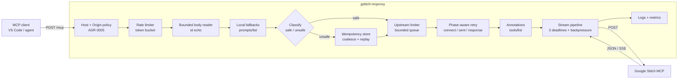

# gstitch-mcproxy

A **zero-dependency** HTTP proxy between MCP clients (VS Code, agents, CLIs) and Google Stitch's
MCP endpoint. It adds credential passthrough, idempotency protection, retries that cannot
duplicate a generation, SSE streaming, logging with a viewer, Prometheus metrics and rate
limiting — in one `node index.js` with no `npm install`.

> **Why idempotency matters:** Stitch tools create projects, generate screens and spend
> generation quota. A transparent proxy that retries after a connection reset can create the same
> project three times. This proxy classifies every request and refuses to repeat a non-idempotent
> call whose outcome is unknown. See [ADR 0003](./docs/adr/0003-idempotency.md).

## Architecture



## Request classification and idempotency

Every message is classified as **safe** (read-only, replayable) or **unsafe** (has side effects).

| Class  | Messages / tools                                                                                                                                                                          |
| ------ | ----------------------------------------------------------------------------------------------------------------------------------------------------------------------------------------- |
| safe   | `initialize`, `ping`, `tools/list`, `prompts/list`, `resources/list`, `resources/templates/list`, all `notifications/*`                                                                   |
| safe   | `tools/call` → `list_projects`, `get_project`, `list_screens`, `get_screen`, `list_design_systems`                                                                                        |
| unsafe | `tools/call` → `create_project`, `create_design_system`, `update_design_system`, `apply_design_system`, `create_screen`, `edit_screens`, `generate_screen_from_text`, `generate_variants` |
| unsafe | **any unknown tool or method** (conservative default)                                                                                                                                     |

Overrides: `SAFE_TOOLS` and `UNSAFE_TOOLS` (comma-separated) always win. A batch takes the most
unsafe element.

### What is retried

Retries are decided by **error phase**, not by message text:

| Class  | connect-phase failure        | sent, no response | HTTP 429/502/503/504          |
| ------ | ---------------------------- | ----------------- | ----------------------------- |
| safe   | retry                        | retry             | retry (honours `Retry-After`) |
| unsafe | **retry** (nothing was sent) | **never**         | **never**                     |

Backoff is exponential with full jitter.

### What is coalesced, replayed, or detached

- **Coalesced** — two identical _unsafe_ calls in flight at once produce **one** upstream request.
  Each caller receives its own JSON-RPC `id`; the second response carries `X-Proxy-Coalesced: true`.
- **Replayed** — a completed unsafe result is stored for `REPLAY_WINDOW_MS` (10 min). A retry of
  the identical call gets it back with `X-Proxy-Replayed: true`.
- **Detached** — if the client disconnects or the proxy times out, an unsafe request keeps running
  for up to `UNSAFE_MAX_DURATION_MS` (10 min) and its result is stored undelivered. The client got
  `504 -32004`; an identical retry collects the result instead of starting a second generation.
- **Explicit keys** — an `Idempotency-Key` header or `params._meta.idempotencyKey` replays a
  completed result **even if it was already delivered**. Without a key, a delivered result is not
  replayed, so a deliberate second generation still runs.

### `-32008` — outcome unknown

An unsafe request that failed _after_ being sent returns HTTP 502 with JSON-RPC `-32008`:

> Outcome unknown: the request may have been applied by Stitch before the connection failed.
> Call `list_screens` or `list_projects` to check before retrying.

That is deliberately actionable: check the state, then retry the **identical** call (which is safe
because the result is replayed).

## Security model

The proxy is built for a **trusted private network**. It allows LAN clients and refuses the public
internet. Full rationale: [ADR 0005](./docs/adr/0005-security.md); reporting: [SECURITY.md](./SECURITY.md).

| Control                                  | Behaviour                                                                                                             |
| ---------------------------------------- | --------------------------------------------------------------------------------------------------------------------- |
| Bind address                             | `0.0.0.0` by default so LAN machines can connect (owner decision 1)                                                   |
| Origin                                   | No `Origin` ⇒ allowed (non-browser). Browser origins allowed only for private-network hosts. `CORS_ORIGIN=*` opts out |
| Host                                     | Public host names refused (DNS-rebinding control). `ALLOWED_HOSTS=*` for a reverse proxy                              |
| CORS                                     | Only `/mcp` emits CORS, with `Vary: Origin`                                                                           |
| Viewer / logs / metrics / verbose health | Local network only; no CORS                                                                                           |
| `/health`                                | Public: `{status, version, uptime}`. Full document at `?verbose=1` (LAN only)                                         |
| Rate limiting                            | On by default: 100 rps, burst 200 (owner decision 5)                                                                  |
| `X-Forwarded-For`                        | Ignored unless `TRUST_PROXY=true`                                                                                     |
| Redaction                                | Credential headers masked; `key=`/`api_key=`/`token=` query params scrubbed                                           |
| HTML pages                               | CSP, `nosniff`, `no-referrer`, `X-Frame-Options: DENY`                                                                |

**No authentication token is required** (owner decision 3): being on the LAN is the control. If
your LAN is not trusted, bind `127.0.0.1` or terminate access at a reverse proxy.

## Endpoints

`GET /health`

- Public payload: `{status, version, uptime}`.
- `GET /health?verbose=1` (local network only) returns runtime status, logging config, credential
  availability, resilience settings and live metrics.
- `HEAD` is supported on both, so container healthchecks work.

`GET /metrics`

- Returns Prometheus-format metrics: request counts, latency histogram, error rates, active connections, rate-limited count, uptime.
- Local network only; no CORS.

`GET /instructions`

- Returns formatted HTML by default.
- Returns structured JSON with `Accept: application/json`.
- Returns raw markdown with `Accept: text/markdown`.

`POST /mcp`

- Proxies MCP requests to Stitch with **SSE streaming** for long-running operations.
- Classifies each request and applies the retry/coalescing/replay rules above.
- Forwards `MCP-Protocol-Version`, `Mcp-Session-Id`, `Last-Event-ID`, `Mcp-Method`, `Mcp-Name` and
  `Mcp-Param-*`, and returns the upstream's session/retry/auth headers unchanged.
- Echoes the JSON-RPC `id` in every error response.
- Enforces rate limits, request timeouts, body size limits and a concurrency cap.
- Answers `GET`/`DELETE`/`PUT`/`HEAD` locally with a JSON-RPC 405 (Stitch only implements `POST`).
- Answers `prompts/list` locally with an empty list (Stitch resets the stream for it).

`GET /logs`

- Opens an interactive log viewer dashboard in the browser (local network only).
- Sidebar lists projects and their log files, plus the summary log.
- Main pane displays log content with line numbers and live search filtering.

`GET /api/logs`

- Returns JSON metadata: summary log info and list of all project log directories with file counts.

`GET /api/logs/summary?limit=200&offset=0`

- Returns paginated lines from the summary log (`logs/proxy.log`).

`GET /.well-known/oauth-protected-resource`, `GET /.well-known/openid-configuration`, `GET /auth`, `POST /token`

OAuth discovery stubs. VS Code probes these when an MCP server URL is configured without a token;
without them the client logs discovery errors before falling back. `/auth` answers `200 OK`, and
`/token` returns a static `local-proxy-token`.

> **These are not authentication.** The token is a fixed placeholder and grants nothing: the proxy
> has no auth layer by design (owner decision 3; see [SECURITY.md](./SECURITY.md)). They exist only
> to stop client-side discovery noise. The issued URL currently uses `http://localhost:<port>`;
> behind a public hostname, override it at your reverse proxy.

`GET /api/logs/{projectId}/{filename}`

- Returns the raw text content of a specific debug log file.
- Protected against path traversal attacks (returns 403 on escape attempts).

## Credential Contract

This proxy accepts the API key from request headers:

```http
STITCH_API_KEY: <your-api-key>
```

The project ID is **not** read from headers. It can be configured in two ways:

1. **Environment default** (optional) — set `STITCH_PROJECT_ID` in `.env` to be used as a fallback for every request.
2. **Per-tool arguments** — pass it as `arguments: { projectId: "..." }` in the tool call body. Agents should tell the assistant the project ID in chat, and the assistant will thread it into the relevant tool calls.

The Stitch API itself will surface a clear error if a project ID is required and none is supplied. Any `STITCH_PROJECT_ID` (or `X-Stitch-Project-Id`) request headers sent by older clients are silently ignored for backward compatibility.

Environment fallback example:

```dotenv
STITCH_API_KEY=your-api-key
# Optional — provides a default projectId when tools don't supply one
STITCH_PROJECT_ID=your-project-id
```

## VS Code MCP Example

```json
{
  "servers": {
    "local/stitch": {
      "type": "http",
      "url": "http://localhost:11401/mcp",
      "auth": {
        "type": "none"
      },
      "headers": {
        "STITCH_API_KEY": "${input:stitch_api_key}"
      }
    }
  }
}
```

> **Note:** `STITCH_PROJECT_ID` is intentionally **not** in the headers. Either set it in your server `.env`, or have the agent pass it through `arguments.projectId` on each tool call.

> **Note:** Do **not** add a `requestTimeout` field. VS Code's HTTP MCP schema only accepts
> `type`, `url`, `headers`, and `oauth`; unknown fields are silently ignored. Long-running
> Stitch calls (60s+) are handled by the proxy's own `REQUEST_TIMEOUT_MS` setting.

## Logging

Summary log:

- `logs/proxy.log`

Debug mode also writes per-project request/response files:

- `logs/<projectId>/<timestamp>-<requestId>.log`

Relevant env vars:

```dotenv
LOG_ENABLED=true
LOG_LEVEL=debug
LOG_DIR=logs
LOG_FILE_NAME=proxy.log
LOG_MAX_BODY_CHARS=20000
LOG_MAX_FILE_SIZE_BYTES=5242880
LOG_MAX_ROTATED_FILES=5
LOG_SKIP_MCP_GET=true
LOG_SKIP_MCP_METHODS=initialize,notifications/initialized,notifications/progress,ping
LOG_SLOW_REQUEST_MS=2000
LOG_VERY_SLOW_REQUEST_MS=5000
LOG_VIEWER_ENABLED=true
LOG_VIEWER_MAX_FILE_BYTES=10485760
LOG_SUMMARY_MAX_LINES=200
```

## Log Viewer

Open `http://localhost:8787/logs` in a browser to access the log viewer dashboard.

**Features:**

- **Summary tab**: View the proxy summary log (`proxy.log`) with line numbers.
- **Projects tab**: Browse per-project debug logs organized by project ID. Click a project to expand its timestamped log files.
- **Live filter**: Type in the search box to highlight matching lines and hide non-matching ones (e.g., "ERROR", "SLOW", "tools/list").
- **Refresh button**: Reloads the file list from disk.

**Configuration:**

| Variable                    | Default            | Description                                            |
| --------------------------- | ------------------ | ------------------------------------------------------ |
| `LOG_VIEWER_ENABLED`        | `true`             | Enable/disable the `/logs` and `/api/logs/*` endpoints |
| `LOG_VIEWER_MAX_FILE_BYTES` | `10485760` (10 MB) | Max file size served by the viewer                     |
| `LOG_SUMMARY_MAX_LINES`     | `200`              | Default page size for summary log API                  |

**Security:** All file paths are validated against path traversal. Requests that attempt to escape the `logs/` directory receive a 403 response.

## SSE Streaming

The proxy detects `text/event-stream` responses and **streams them** instead of buffering, which
matters for `generate_screen_from_text` and `edit_screens` (60 s+). Streaming uses a real
`pipeline()`, so a slow client applies backpressure instead of making the proxy buffer the body.

Three independent deadlines apply, and they are deliberately not the same rule:

| Deadline | Variable                 | Default | Meaning                             |
| -------- | ------------------------ | ------- | ----------------------------------- |
| headers  | `REQUEST_TIMEOUT_MS`     | 120 s   | until Stitch sends response headers |
| idle     | `STREAM_IDLE_TIMEOUT_MS` | 60 s    | longest silence _between_ chunks    |
| total    | `STREAM_MAX_DURATION_MS` | 30 min  | absolute cap for one streamed body  |

A slow-but-alive stream survives the idle limit; a stalled one does not have to wait for the total
limit. A client disconnect aborts the upstream read for safe calls, so the proxy stops paying for
work nobody is waiting for.

Stream capture for the debug log is bounded by `LOG_MAX_BODY_CHARS` and only happens when
`LOG_LEVEL=debug`.

## Resilience & Safety

| Variable                       | Default        | Description                                                                 |
| ------------------------------ | -------------- | --------------------------------------------------------------------------- |
| `REQUEST_TIMEOUT_MS`           | `120000`       | Upstream **headers** deadline. Returns 504.                                 |
| `MAX_BODY_SIZE_BYTES`          | `10485760`     | Maximum request body. Returns 413.                                          |
| `STREAM_IDLE_TIMEOUT_MS`       | `60000`        | Longest silence between stream chunks.                                      |
| `STREAM_MAX_DURATION_MS`       | `1800000`      | Absolute cap for a streamed body.                                           |
| `RATE_LIMIT_ENABLED`           | `true`         | Token-bucket rate limiting (owner decision 5).                              |
| `RATE_LIMIT_MAX_RPS`           | `100`          | Requests per second per client.                                             |
| `RATE_LIMIT_BURST`             | `200`          | Maximum burst.                                                              |
| `MAX_CONCURRENT_UPSTREAM`      | `32`           | Concurrent upstream requests; `0` disables the cap.                         |
| `CONCURRENCY_QUEUE_WAIT_MS`    | `10000`        | Then `503` + `Retry-After` + `-32009`.                                      |
| `CORS_ORIGIN`                  | _(empty)_      | Empty = private-network origins only. `*` restores the old permissive mode. |
| `ALLOWED_ORIGINS`              | _(empty)_      | Extra origins beyond the private-network default.                           |
| `ALLOWED_HOSTS`                | _(empty)_      | Extra `Host` values; `*` accepts any.                                       |
| `TRUST_PROXY`                  | `false`        | Trust `X-Forwarded-For` (only behind your own proxy).                       |
| `SHUTDOWN_DRAIN_MS`            | `15000`        | Drain budget on SIGTERM/SIGINT.                                             |
| `UPSTREAM_RETRY_ENABLED`       | `true`         | Retry per the phase table above.                                            |
| `UPSTREAM_RETRY_ATTEMPTS`      | `3`            | Max attempts per upstream request.                                          |
| `UPSTREAM_RETRY_BASE_DELAY_MS` | `250`          | Full-jitter backoff base.                                                   |
| `LOCAL_FALLBACK_METHODS`       | `prompts/list` | Methods answered locally.                                                   |
| `SAFE_TOOLS` / `UNSAFE_TOOLS`  | _(empty)_      | Classification overrides.                                                   |
| `UNSAFE_MAX_DURATION_MS`       | `600000`       | Background limit for a detached unsafe request.                             |
| `REPLAY_WINDOW_MS`             | `600000`       | How long a stored result may be replayed.                                   |
| `ANNOTATE_TOOLS`               | `true`         | Inject `readOnlyHint`/`destructiveHint` into `tools/list`.                  |

The complete, drift-tested inventory lives in [PROGRESS.md](./PROGRESS.md#6-environment-variable-inventory)
and [.env.example](./.env.example). `test/config.test.js` fails if the three disagree.

**Origin and Host validation:** per the MCP Streamable HTTP spec, `Origin` is validated on every
connection and an invalid value receives HTTP 403. `Host` is validated as well, which is what
prevents DNS rebinding.

## Upstream Resilience

Stitch occasionally resets the HTTP/2 stream mid-request. Node's `fetch()` reports this as a
bare `TypeError: fetch failed`, hiding the real cause (`ERR_HTTP2_STREAM_ERROR`). The proxy:

1. **Unwraps the cause** — logs `fetch failed (ERR_HTTP2_STREAM_ERROR)` instead of `fetch failed`.
2. **Retries by error phase** — a _connect_-phase failure never reached Stitch, so any request may
   be repeated. A failure after the request was sent is retried only for read-only calls; for a
   mutating call it returns `-32008` instead, because Stitch may already have applied it.
3. **Returns JSON-RPC errors** — upstream failures return HTTP 502 with a JSON-RPC error object
   (`-32006`, or `-32008` for an unknown outcome) rather than a plain-text body, so MCP clients
   can parse them.
4. **Never loses a generation** — if the client goes away, a read-only call is aborted (logged as
   `499`), while a mutating call is _detached_ and its result stored for the retry.

### Methods Stitch does not implement

Stitch resets the HTTP/2 stream for `prompts/list` (it returns no response at all). Clients
see this as `fetch failed` and some retry capability discovery in a tight loop — the logs
showed ~29,000 failed discovery cycles in a single day. The proxy now answers
`prompts/list` locally with `{"prompts": []}`, which is spec-compliant and stops the loop.

`GET`, `DELETE`, and `PUT` on `/mcp` are also answered locally with a JSON-RPC 405. Stitch
returns a Google HTML error page for these, which is not a valid MCP response.

The code also carries empty results for `resources/list` and `resources/templates/list`, but
leaves them **out** of `LOCAL_FALLBACK_METHODS` because whether Stitch implements them has never
been verified (finding P4 in `PROGRESS.md`). `scripts/live-probe.js` answers that question against
the real endpoint; see [Probing P4](#probing-p4) below.

## Metrics (Prometheus)

`GET /metrics` returns Prometheus-format metrics:

| Metric                             | Type      | Description                                               |
| ---------------------------------- | --------- | --------------------------------------------------------- |
| `gstitch_proxy_uptime_seconds`     | gauge     | Proxy uptime                                              |
| `gstitch_proxy_requests_total`     | counter   | Total requests                                            |
| `gstitch_proxy_errors_total`       | counter   | Total errors (5xx)                                        |
| `gstitch_proxy_active_connections` | gauge     | Current active connections                                |
| `gstitch_proxy_rate_limited_total` | counter   | Rate-limited requests                                     |
| `gstitch_proxy_requests_by_method` | counter   | Requests by HTTP method + path                            |
| `gstitch_proxy_requests_by_status` | counter   | Requests by HTTP status code                              |
| `gstitch_proxy_latency_seconds`    | histogram | Request latency buckets (100ms, 500ms, 1s, 5s, 30s, 120s) |

Disable with `METRICS_ENABLED=false`.

## Docker

```bash
# Preferred
docker compose up -d

# Or manually
docker build -t gstitch-mcproxy .
docker run -d -p 8787:8787 \
  -e STITCH_API_KEY=your-key \
  -e STITCH_PROJECT_ID=your-project \
  -v "$(pwd)/logs:/app/logs" \
  gstitch-mcproxy
```

The image is deliberately minimal and hardened:

- `node:22-alpine`, no `npm install` — the project has **no runtime dependencies**;
- runs as the unprivileged `node` user;
- healthcheck uses the bundled `node` (not BusyBox `wget`) and validates the JSON body;
- `STOPSIGNAL SIGTERM`, so the graceful shutdown drain runs;
- `docker-compose.yml` sets `read_only: true`, a `/tmp` tmpfs, `no-new-privileges`, and mounts
  only `logs/` writable.

The compose file publishes `8787:8787` so other LAN machines can connect (owner decision 1).
Change it to `127.0.0.1:8787:8787` to keep it on this host, and set
`LOG_VIEWER_ENABLED=true` if you want the dashboard in the container.

## Development

```bash
npm install        # dev-only tooling: eslint, prettier, typescript
npm run verify     # lint + typecheck + test
npm run test:coverage
```

The suite runs each test **file** in its own process. Configuration is still process-global in
the Phase 1 seam, so two proxies with _different_ configuration cannot listen in the same process —
`createProxyServer()` refuses that explicitly rather than silently reconfiguring the first.

Layout (see [ADR 0002](./docs/adr/0002-module-layout.md)):

```
index.js                 entry point: config, createProxyServer, listen, signals
src/config-ish helpers   inside index.js today; Phase 6 owns the schema
src/http/                respond, security (origin/host/CORS/redaction), ratelimit
src/mcp/                 jsonrpc parsing, classification, annotations
src/upstream/            errors, retry policy, stream pipeline, limiter
src/idempotency/         coalescing + replay store
src/observability/       metrics
docs/adr/                architecture decisions
```

CI runs lint, typecheck, format check, the full suite with coverage, a zero-runtime-dependency
assertion, a smoke test of `node index.js`, and a container healthcheck on Node 20/22/24.

## Quick Test

`test.sh` is an **opt-in live smoke test** that talks to the real Stitch endpoint using your key.
It is never part of `npm test` (which uses a local fake upstream) and it reports the key as
`configured`/`missing` rather than printing it.

```bash
STITCH_LIVE=1 ./test.sh
```

### Probing P4

`scripts/live-probe.js` is the second opt-in live script. It asks Stitch directly whether it
implements `resources/list` and `resources/templates/list` — the one question about the upstream
that cannot be answered from code or from the fake upstream.

It sends **read-only discovery calls only** (`initialize`, `tools/list`, then the three list
methods); no project is touched and no generation quota is spent. `tools/list` is the control: if
it fails, the other rows are reported as inconclusive and the script exits `1`.

```bash
STITCH_API_KEY=... npm run probe:live -- --i-understand
```

Three guards, because it spends your credential:

- `--i-understand` is required; without it the script prints usage and exits `2`;
- it refuses to run when `CI` is set, and the suite never invokes it (`test/probe.test.js` asserts this);
- the key is read from `STITCH_API_KEY` only — never from an argument, where it would land in shell history.

Add `--json` for machine-readable output. The last line of the report is the exact summary to
record in `PROGRESS.md` §10.2 and `test/bugs.test.js` to close the finding.

Run the proxy:

```bash
./run.sh
```

Install it as a systemd service:

```bash
# per-user (starts with your session)
chmod +x install-user-service.sh && ./install-user-service.sh

# system-wide (survives logout; needs sudo)
chmod +x install-system-service.sh && ./install-system-service.sh
```

Both units are hardened: `NoNewPrivileges`, `ProtectSystem=strict`, `PrivateTmp`,
`RestrictAddressFamilies`, an empty capability set, `MemoryMax` and a `TimeoutStopSec` that
exceeds `SHUTDOWN_DRAIN_MS`.

Useful service commands:

```bash
systemctl --user status gstitch-mcproxy
systemctl --user restart gstitch-mcproxy
journalctl --user -u gstitch-mcproxy -f
```

### Reverse proxies

`STITCH_API_KEY` contains an underscore. nginx drops such headers by default, so either enable
`underscores_in_headers on;` or send `X-Stitch-Api-Key` instead. Set `TRUST_PROXY=true` only if
your proxy is the thing setting `X-Forwarded-For`, and `ALLOWED_HOSTS` if it presents a public
`Host` header.

### Ports

The code default and the docs agree on **8787**. Earlier versions of this README and
`.env.example` mixed `8787` with `11401`; set `MCP_SERVER_PORT` explicitly if your client config
uses something else.
